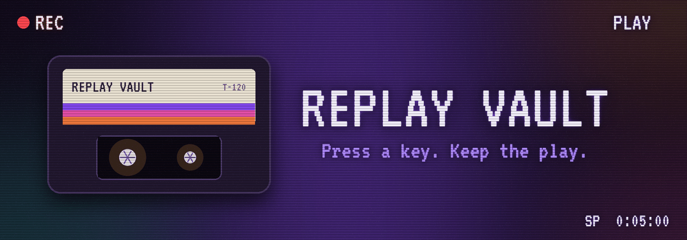
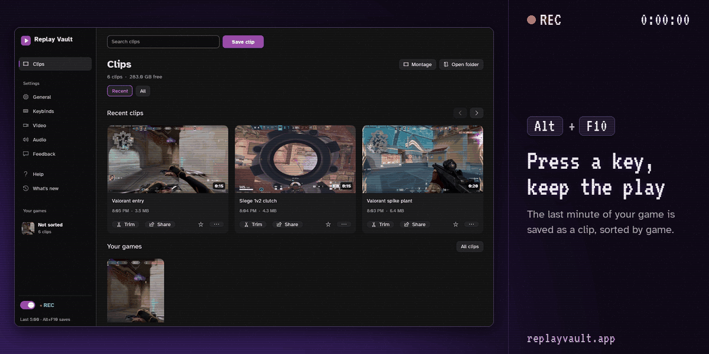

<p align="center">
  
</p>

<p align="center">
  <b>Free, open-source instant replay for Windows.</b><br>
  It keeps the last few minutes of your game in memory. Press <kbd>Alt</kbd> + <kbd>F10</kbd> and they're saved as a clip.
</p>

<p align="center">
  <a href="../../releases/latest"></a>
  <a href="https://replayvault.app"></a>
  <a href="https://discord.gg/n2KYWUPqGY"></a>
</p>

<p align="center">
  
  
</p>

<p align="center">
  
</p>

## How it works

| 1. It keeps rolling | 2. You press the key | 3. It's a clip |
|---|---|---|
| Your screen and sound are recorded into memory, round and round. Nothing is written to disk yet. | Right after the moment, from inside the game: <kbd>Alt</kbd> + <kbd>F10</kbd>, or your own key. | The last minute (or up to 20) lands in your clips folder, ready to watch, trim or share. |

Recording is done by a private, hidden copy of [OBS Studio](https://obsproject.com) that the app downloads and manages, so you get OBS's GPU encoding without setting up OBS. If you already use OBS, your own install and its settings are not changed.

## What's on the tapes

**Recording**
- Instant replay from 10 seconds to 20 minutes, or keys that save just the last 30 or 60 seconds
- Full recording and screenshots on their own keys
- Desktop capture by default, which is safe with anti-cheat. Game capture is there if you want it.
- Game and mic on separate tracks, noise suppression, or record only the apps you pick

**Clips and trim**
- A clips page with folders per game, search, stars and tags
- Hover over a clip to scrub through it, or play it in the built-in player
- Trim with an audio waveform and a volume per track
- Copies sized for Discord, 720p or vertical 9:16, GIFs and a montage maker

**Sharing**
- Post to your Discord channel through your own webhook
- Upload for a share link, and keep the link that deletes it later
- Clean up old clips by size or age, and move old ones to an archive drive

## Requirements

- Windows 10 or 11, 64-bit
- A graphics card with a hardware video encoder is recommended. Only NVIDIA cards have been tested so far. AMD and Intel graphics, and CPU-only recording, are untested.

## Install

1. Download the latest installer (`ReplayVault-<version>-setup.exe`) or the portable zip from [Releases](../../releases). The installer does not need administrator rights.
2. Run it. A short setup asks for your clips folder, save key, screen and sound devices.
3. On first run the app downloads OBS Studio (about 225 MB) into its own folder and checks it against the published SHA-256 hash.

Each release includes `SHA256SUMS.txt`. To verify a download, compare it with the output of `Get-FileHash <file>`.

> [!NOTE]
> Releases are not code-signed yet, so Windows SmartScreen may show a warning the first time you run the app.

## Default keys

| Action | Key |
|---|---|
| Save the replay | <kbd>Alt</kbd> + <kbd>F10</kbd> |
| Show or hide the window | <kbd>Alt</kbd> + <kbd>X</kbd> |
| Start or stop a recording | <kbd>Alt</kbd> + <kbd>F11</kbd> |
| Screenshot | <kbd>Alt</kbd> + <kbd>F12</kbd> |
| Turn instant replay on or off | <kbd>Alt</kbd> + <kbd>Shift</kbd> + <kbd>F11</kbd> |

All keys can be changed on the Keybinds page. They avoid NVIDIA's and AMD's default shortcuts, which those apps keep even with their overlays off. If another app already uses a key you pick, the Keybinds page says which one.

## Privacy

Replay Vault has no accounts, tracking or analytics. It connects to the internet only to:

- download and update OBS Studio and the Microsoft Visual C++ runtime it needs
- look up game cover art on Steam by the game's name (can be turned off)
- check GitHub once a day for a newer version of Replay Vault (can be turned off), and download it only when you click Install now
- send feedback, upload a share link or post to Discord, and only when you use those features

Clips, settings and logs stay on your PC: clips in `Videos\Replay Vault Clips` by default, settings and logs in `%APPDATA%\replay-vault`, and the private OBS copy in `%LOCALAPPDATA%\replay-vault`.

## Uninstall

Use **General > Remove from this PC** in the app. It undoes the changes the app made (startup entry, firewall rule, GPU preference and any Windows settings you turned off), moves the private OBS copy and the app's settings to the Recycle Bin, then uninstalls the app and its shortcuts. Your clips are kept.

## Building from source

You need [Rust](https://rustup.rs) (stable) on Windows 10 or 11.

```
cargo build --release
cargo test
```

The executable is written to `target\release\replay-vault.exe`. Release packages are built by `tools\release.ps1`, which also needs [Inno Setup 6](https://jrsoftware.org/isinfo.php) for the installer. Pushing a `v*` tag builds a draft release with GitHub Actions.

## Code signing policy

Windows releases will be signed through the [SignPath Foundation](https://signpath.org) program, with a certificate issued to SignPath Foundation. Until then, releases are unsigned.

- Only builds made by this repository's GitHub Actions release workflow from a tagged commit are signed.
- Committer, reviewer and approver: [ItsFlamme](https://github.com/ItsFlamme). Every signing request is approved manually.

## Support

- Bugs and feature requests: [GitHub Issues](../../issues)
- Help and community: [Discord](https://discord.gg/n2KYWUPqGY)
- Security issues: see [SECURITY.md](SECURITY.md)

## License

Licensed under the [Apache License 2.0](LICENSE). Redistributions must keep the [NOTICE](NOTICE) file.

OBS Studio is licensed under GPL-2.0-or-later. It is downloaded from the official release and run unmodified, not bundled. Other third-party components are listed in [THIRD-PARTY-NOTICES.md](THIRD-PARTY-NOTICES.md). Replay Vault is not affiliated with the OBS Project, NVIDIA, AMD or Intel.
